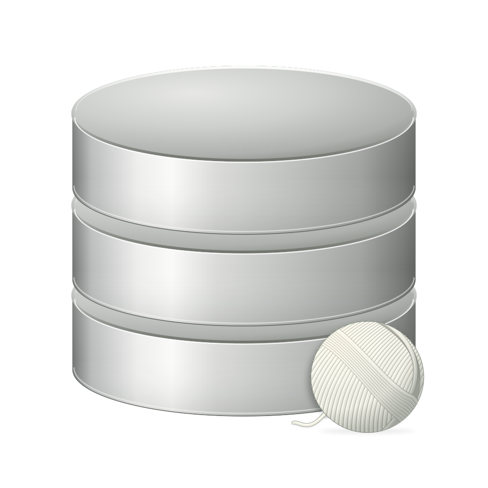
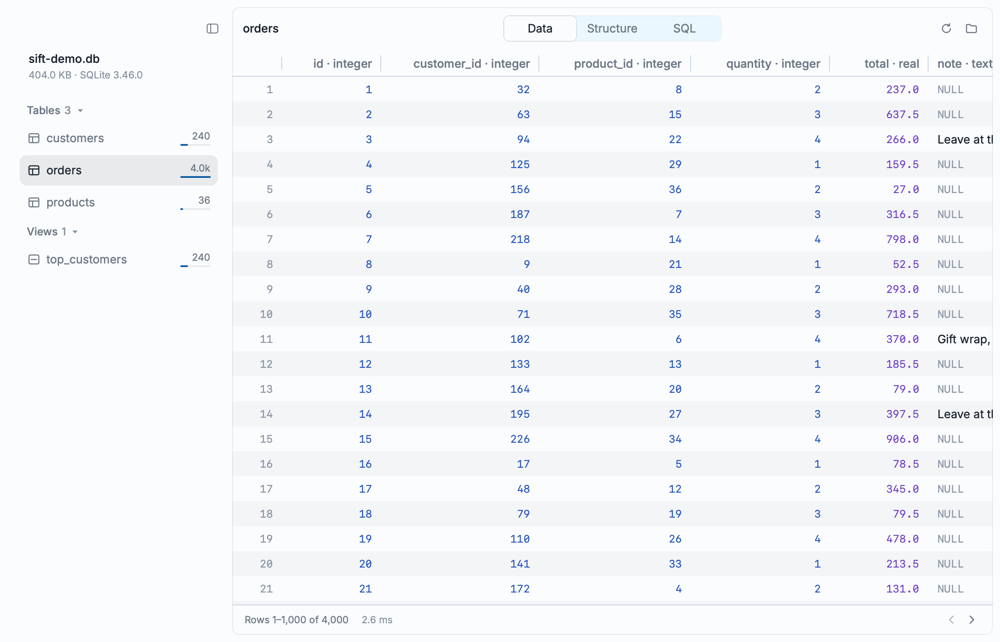
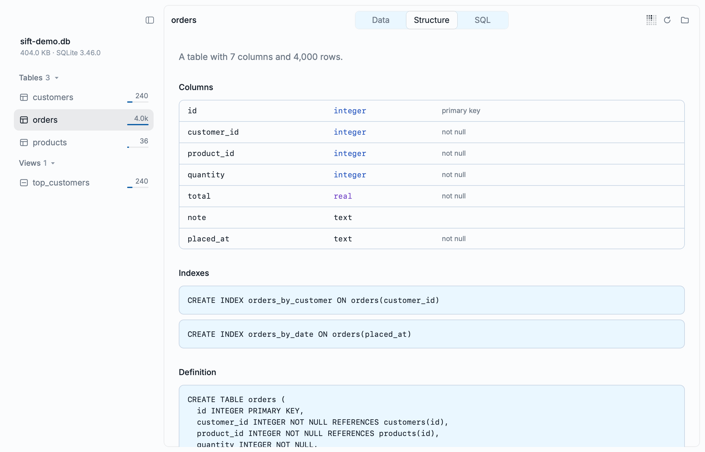
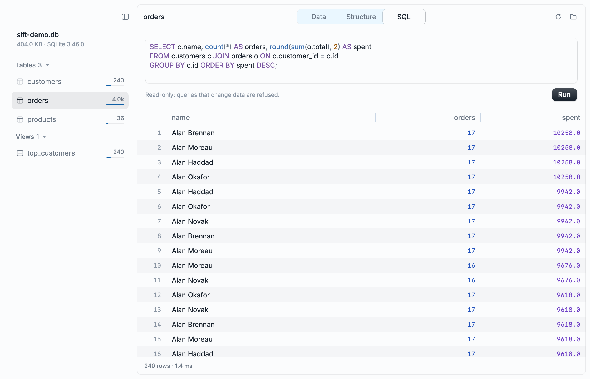

<p align="center">
  
</p>

<h1 align="center">Sift</h1>

<p align="center">A clean, native, read-only SQLite viewer for macOS, written in Rust.</p>

<p align="center">
  <a href="https://github.com/m4nik1/sift/releases/latest"><b>Download for macOS</b></a>
</p>

<picture>
  <source media="(prefers-color-scheme: dark)" srcset="shots/demo-dark.png">
  
</picture>

## Features

- **Browse tables and views**, 1,000 rows per page, with click-to-sort on any column.
- **Structure tab** shows each table's columns, types, primary keys, `NOT NULL` constraints, indexes and its `CREATE` statement.
- **SQL tab** runs ad-hoc queries (up to 5,000 rows) and shows how long they took.
- **Read-only.** Sift opens databases with `SQLITE_OPEN_READ_ONLY`, so it can't change your data.
- **Find open databases.** The start screen lists SQLite files other apps currently have open (Chrome history, Messages, your dev server…), plus your recent files.
- **Native and fast.** GPU-rendered with [Rune](https://github.com/anomalyco/rune). Queries run off the UI thread. Light and dark mode follow the system.

<table>
  <tr>
    <td><picture><source media="(prefers-color-scheme: dark)" srcset="shots/structure-dark.png"></picture></td>
    <td><picture><source media="(prefers-color-scheme: dark)" srcset="shots/sql-dark.png"></picture></td>
  </tr>
  <tr>
    <td align="center">Structure</td>
    <td align="center">SQL</td>
  </tr>
</table>

## Install

1. Download `Sift-<version>-macos-arm64.zip` from the [latest release](https://github.com/m4nik1/sift/releases/latest).
2. Unzip it and drag **Sift.app** to your Applications folder.
3. The app is ad-hoc signed, not notarized, so macOS will block it the first time you open it. Right-click Sift.app, choose **Open**, then confirm. Or clear the quarantine flag yourself:

   ```sh
   xattr -dr com.apple.quarantine /Applications/Sift.app
   ```

You need macOS 13 or later on Apple silicon.

## Usage

Open a database in any of these ways:

- Drop a `.db`, `.sqlite`, `.sqlite3`, `.db3`, `.s3db` or `.sl3` file on the window
- Press **⌘O**
- Type or paste a path on the start screen (**⌘L** focuses the path field)
- Pick a recent file, or a database another app has open
- From a terminal: `sift path/to/file.db`

### Keyboard shortcuts

| Shortcut | Action |
| --- | --- |
| ⌘O | Open a database |
| ⌘L | Focus the path field (start screen) |
| ⌘1 / ⌘2 / ⌘3 | Data / Structure / SQL tab |
| ⌘↩ | Run the query |
| ⌘R | Reload the database |
| ⌘[ / ⌘] | Previous / next page |

## Building from source

Sift builds against a vendored copy of Rune, which is a git submodule. The Rust toolchain version is pinned in `rust-toolchain.toml`, and `rustup` installs it for you.

```sh
git clone --recursive https://github.com/m4nik1/sift.git
cd sift
cargo run --release -- path/to/file.db
```

If you already cloned without `--recursive`, run `git submodule update --init`.

To build the app bundle:

```sh
scripts/bundle.sh            # builds dist/Sift.app
scripts/bundle.sh --install  # also copies it to ~/Applications
```

Run the tests with `cargo test`.

### Screenshots

The images in `shots/` are rendered headlessly from a bundled demo database:

```sh
cargo run --release -- --snap shots/demo-dark.png --scene demo --theme dark --scale 2
```

The available scenes are `demo`, `structure`, `sql` and `welcome`.
